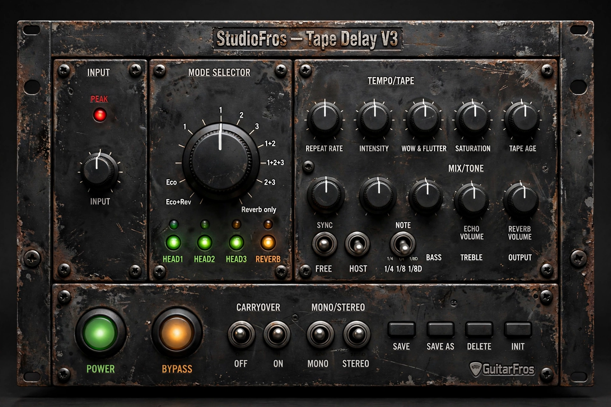

# StudioFros – Tape Delay

**by GuitarFros** · VST3 + Standalone · Linux (also builds on Windows / macOS with JUCE)

A rack-style tape echo that captures the character of the classic studio tape-delay
machines: three playback heads, tape-speed inertia, wow & flutter, saturation, a
progressively "aged" tape (HF loss, hiss, dropouts), a reverb section and a
self-oscillating feedback loop.



## Controls

| Section | Control | What it does |
|---|---|---|
| Input | **INPUT** | Level sent into the tape (the dry signal is not affected). |
| | **PEAK** | Lights when the signal hitting the tape nears clipping. |
| Mode Selector | 15-position dial | Chooses playback heads 1 / 2 / 3 (at 1×, 2×, 3× the base delay), with or without reverb. See table below. |
| | HEAD1-3 / REVERB lamps | Show what the current mode uses. |
| Tempo / Tape | **REPEAT RATE** | Tape speed. Clockwise = faster = shorter delay (head 1: 450 ms → 40 ms). |
| | **INTENSITY** | Feedback. Past ~90 % it self-oscillates (always bounded by the tape saturation). |
| | **WOW & FLUTTER** | Slow wow, fast flutter and random drift of the tape speed. |
| | **SATURATION** | Tape compression / soft clipping on the record side. |
| | **TAPE AGE** | Each repeat gets darker; adds hiss and random dropouts. |
| Mix / Tone | **ECHO VOLUME**, **REVERB VOLUME** | Level of the echoes / the reverb. |
| | **BASS**, **TREBLE** | ±12 dB shelving on the wet signal. |
| | **OUTPUT** | Output level. |
| Sync | **SYNC** switch (left FREE / right HOST) | Delay time from REPEAT RATE, or locked to the host tempo. |
| | **NOTE** switch (3 positions) | In HOST mode: left 1/4, centre 1/8, right dotted 1/8. |
| Bottom | **POWER** | Unit on / off (off = completely out of the signal path). |
| | **BYPASS** | Bypass. |
| | **CARRYOVER** switch (left OFF / right ON) | When bypassed, let the echoes ring out (ON) or cut them (OFF). |
| | **MONO / STEREO** switch (left / right) | STEREO spreads heads 1 / 2 / 3 left / centre / right. |
| Presets | click the display / arrows | Factory + user presets. **SAVE**, **SAVE AS**, **DELETE**, **INIT**. |

Every knob has a tooltip with its real name, and shows its value while you drag it.
Double-click a knob to reset it. The window can be resized (fixed aspect ratio).


### Mode Selector positions

Angles are clockwise from 12 o'clock and match the ticks on the artwork.

| Angle | Heads | Reverb | | Angle | Heads | Reverb |
|---|---|---|---|---|---|---|
| −157.5° | 1+3 | yes | | 0° | 1 | no |
| −135° (Eco+Rev) | 1+2+3 | yes | | 22.5° | 2 | no |
| −112.5° (Eco) | 2+3 | yes | | 45° | 3 | no |
| −90° | 1+2 | yes | | 67.5° | 1+2 | no |
| −67.5° | 3 | yes | | 90° | 1+2+3 | no |
| −45° | 1 | yes | | 112.5° | 2+3 | no |
| −22.5° | 2 | yes | | 135° | 1+3 | no |
| | | | | 157.5° | – | reverb only |

The table lives in `Source/Params.h` (`kModes`) if you want to change it.

## Build (Ubuntu / Debian)

Quick way: `./build_ubuntu.sh` (does everything below).


```bash
sudo apt install build-essential cmake git libasound2-dev libjack-jackd2-dev \
  libfreetype-dev libfontconfig1-dev libx11-dev libxcomposite-dev libxcursor-dev \
  libxext-dev libxinerama-dev libxrandr-dev libxrender-dev libgl1-mesa-dev libcurl4-openssl-dev

git clone https://github.com/guitarfros/StudioFros-TapeDelay.git
cd StudioFros-TapeDelay
cmake -B build -DCMAKE_BUILD_TYPE=Release
cmake --build build -j$(nproc)
```

JUCE is downloaded automatically by CMake (tag `8.0.6`, change it with
`-DSTUDIOFROS_JUCE_TAG=...`, or use a local copy with `-DSTUDIOFROS_JUCE_PATH=/path/to/JUCE`).

**Installation is automatic:** after the build, the VST3 is copied to `~/.vst3/`
(`StudioFros - Tape Delay.vst3`), which is where REAPER looks for VST3 plug-ins on Linux.
Open REAPER → *Options → Preferences → Plug-ins → VST → Re-scan* (or "Clear cache and re-scan")
and look for **StudioFros - Tape Delay (GuitarFros)**.

Standalone app: `build/StudioFros_artefacts/Release/Standalone/StudioFros - Tape Delay`.

To build without copying to `~/.vst3`: `-DSTUDIOFROS_INSTALL_AFTER_BUILD=OFF`.

## Artwork tools

`tools/make_background.py` rebuilds `Assets/background.jpg` from the original artwork
(it re-positions the captions so every control has its own caption slot).

## DSP tests

The DSP engine (`Source/TapeEngine.h`) has no JUCE dependency and can be tested alone:

```bash
g++ -std=c++17 -O2 -ISource tests/engine_test.cpp -o engine_test && ./engine_test
```

## User presets

Saved as small XML files in `~/.config/GuitarFros/StudioFros Tape Delay/Presets/`.

## License

* **Code:** GPL-3.0-or-later (see [LICENSE](LICENSE)).  The plugin links against
  [JUCE](https://juce.com), used here under its AGPLv3 open-source option; the resulting
  combined work must be distributed under AGPL-compatible terms (GPLv3 is compatible).
* **Artwork** (`Assets/`, `docs/preview.jpg`): see [ASSETS_LICENSE.md](ASSETS_LICENSE.md).
* VST is a trademark of Steinberg Media Technologies GmbH.
* Not affiliated with Roland or any other maker of tape-echo units; all product names
  belong to their owners.
